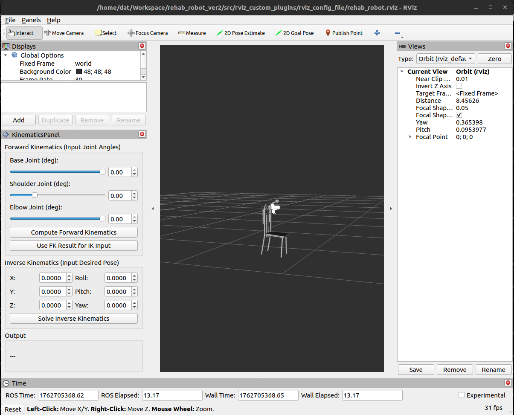

ros2 param set /rviz2 robot_description_semantic "$(cat /home/dat/Workspace/rehab_robot_ver2/src/rviz_custom_plugins/config/rehab_robot_ver2.srdf)"

ros2 launch rviz_custom_plugins rviz_launch.launch.py

base_joint,shoulder_joint,elbow_joint
0,-1.05,0

ros2 topic pub --once /InverseKinematics/response rviz_custom_plugins/msg/KinematicsIKResponse \
"{joint_names: ['base_joint', 'shoulder_joint', 'elbow_joint'], joint_positions: [-0.261799, -0.261799, 0.261799], status: 'ok'}"

sudo ip link set can0 up type can bitrate 500000

### cách chạy code
## code hoạt động theo luồng dữ liệu như thế nào
nhìn chung thì code sẽ có 3 phần chính: giao diện rviz, bộ tính kinematics và bộ giao tiếp với động cơ
chạy thì dùng 2 file launch:

# launch bộ giao tiếp
ros2 launch rehab_robot_ver2_control controller_stateReader.launch.py

# launch giao diện rviz và kinematics
ros2 launch rviz_custom_plugins rviz_launch.launch.py

## cách sử dụng giao diện

khi mới khởi tạo sẽ được hình như trên

- chỉnh slider của các góc để tính xem vị trí cuối trông thế nào
- ấn Compute FK để thay đổi vị trí trong mô hình và tính FK
- ấn nút use FK ... để chuyển vị trí từ tính FK xuống để tính IK
- ấn Solve để giải IK

## thay đổi vận tốc

ros2 param set /trajectory_tuning_node traj_vel_limit [1.0,3.5]
ros2 param set /trajectory_tuning_node traj_accel_limit [1.0,5.0,5.0]
ros2 param set /trajectory_tuning_node traj_inertia [1.0,10.0]

# điều khiển chỉ bằng lực
ros2 run rehab_robot_ver2_control torque_pub_node

# chạy lệnh điều khiển lực
ros2 topic pub /motor/torque_cmd std_msgs/msg/Float32 "{data: 0.1}"

# chạy các chế độ
ros2 run rehab_robot_ver2_control velocity_modes --ros-args --params-file /home/dat/Workspace/rehab_robot_ver2/src/rehab_robot_ver2_control/config/trajectory_params.yaml

# chuyển dạng .ui sang .py
pyuic5 -x rehab_exercise.ui -o rehab_gui.py

# chạy code admittance control
ros2 run rehab_robot_ver2_control admittance_control

ros2 param set /admittance_control M_admittance 1.5
ros2 param set /admittance_control B_admittance 4.0
ros2 param set /admittance_control K_admittance 15.0

# test velocity
ros2 run rehab_robot_ver2_control simple_velocity_node
ros2 param set /simple_velocity_node target_velocity_2 1.5
ros2 param set /simple_velocity_node target_velocity_1 1.5

# Tập lệnh điều khiển odrivetool

# bật điện trở 120Ω
odrv0.can.config.enable_r120 = True
odrv0.axis0.controller.config.input_mode
odrv0.axis0.controller.config.control_mode = CONTROL_MODE_VELOCITY_CONTROL
odrv0.axis0.requested_state = AXIS_STATE_CLOSED_LOOP_CONTROL
odrv0.axis0.controller.config.vel_gain

ros2 run plotjuggler plotjuggler
sudo ip link set can0 up type can bitrate 500000
ros2 run rehab_robot_ver2_control simple_velocity_node
ros2 run rehab_robot_ver2_control data_pub_node

# chay code admittance control + gravity compensation
ros2 run rehab_robot_ver2_control node_gravity_compensation_elbow